# Lab2：物理内存和页表实验报告

## 实验基本信息

| 项目 | 内容 |
|---|---|
| 实验名称 | Lab2：物理内存和页表 |
| 小组成员 | 2413603-常侯鑫、2411834-张岩、2413404-邓耀飞 |
| 完成日期 | 2026-10-25 |

### 小组分工

| 成员 | 负责的练习或模块 |
|---|---|
| 2413603-常侯鑫 | 物理内存探测、Page 描述符初始化与 `page_init()`；SLUB 实现与测试；QEMU MMU 双 GDB 调试；集成验证及报告整合 |
| 2411834-张岩 | Buddy System 分配算法、构建接入与测试；对应模块报告编写 |
| 2413404-邓耀飞 | First-Fit 分析、Best-Fit 连续物理内存分配算法与验证；对应模块报告编写 |

---

## 一、实验目的

本实验围绕物理内存的发现、初始化和分配展开，主要目标如下：

1. 理解设备树 Memory 节点提供的内存范围如何转化为内核可管理的物理页。
2. 理解 `Page` 描述符与物理页之间的转换关系，以及内核虚拟地址和物理地址之间的固定偏移映射。
3. 理解 `pmm_manager` 接口如何把具体分配算法与物理内存初始化过程解耦。
4. 分析 First-Fit 的分配与释放过程，实现并验证 Best-Fit 连续页分配器。
5. 实现基于空闲块阶链表的 Buddy System，支持伙伴块分裂与合并。
6. 处理非二次幂页数请求、内存不足和任意初始连续空闲区间。
7. 使用真实 RISC-V 内核镜像和 QEMU 验证分配器的状态不变式。

---

## 二、实验环境

| 项目 | 实际使用情况 |
|---|---|
| 宿主环境 | Windows + WSL Ubuntu 24.04 |
| 目标架构 | RISC-V 64 位 |
| 模拟器 | QEMU 4.1.1，`virt` 机器 |
| 固件 | QEMU 自带 OpenSBI v0.4 |
| 交叉编译器 | SiFive GCC-Metal 10.2.0-2020.12.8，`riscv64-unknown-elf-gcc` 10.2.0 |
| 构建工具 | GNU Make 4.3 |
| 内核调试器 | 工具链中的 `riscv64-unknown-elf-gdb` |
| 宿主调试器 | 原生 x86-64 GDB |
| 运行内核 | `code/bin/ucore.img` |

编译、链接和 QEMU 验证均在 WSL 中完成。测试使用真实内核启动路径，没有用宿主程序模拟替代内核内分配器。

### AI 工具使用情况

| 成员 | AI 编程工具 | 底层模型 | 备注 |
|------|------------|---------|------|
| 2413603-常侯鑫 | Codex | GPT-6.1 sol | 初始化、SLUB、页表调试及集成验证 |
| 2411834-张岩 | Codex | DeepSeek-V4-Flash | Buddy System 实现与测试 |
| 2413404-邓耀飞 | Codex | GPT-6.1 sol | First-Fit 分析与 Best-Fit 实现 |

### 环境隔离与构建配置

Makefile 的默认 `PMM` 改为 `best_fit`；`pmm.c` 已有 `PMM_BEST_FIT` 条件选择，
三种分配器通过统一接口接入。
切换 `PMM` 前必须 `make clean`，因为目标文件名不包含该选项。

实验使用独立的 OS 课程环境，工具链为 RISC-V 交叉编译器，模拟器为 QEMU 4.1.1，
调试使用 RISC-V GDB 和宿主机 GDB。该环境与其他课程的实验环境分开使用。

环境准备完成后，在 WSL 终端的 `code` 目录执行：

```bash
qemu-system-riscv64 --version
riscv64-unknown-elf-gcc --version
```

在 `code` 目录中执行默认配置的构建与评分：

```bash
make clean
make PMM=best_fit
make PMM=best_fit grade
```

First-Fit 回归使用 `make clean`、`make PMM=first_fit` 和 `make PMM=first_fit qemu`；Buddy 自动检查使用 `make check-buddy`。

---

## 三、实验整体逻辑分析

### 3.1 本章节的逻辑主线

Lab2 的物理内存管理流程可以概括为：

```text
QEMU / OpenSBI
      │
      ▼
dtb_init() 解析设备树中的物理内存范围
      │
      ▼
pmm_init()
      │
      ├─ 根据 PMM 选择 First-Fit、Best-Fit 或 Buddy 管理器
      ├─ page_init() 建立 Page 描述符数组，保留内核和固件占用区域
      └─ 将剩余连续空闲页交给当前管理器的 init_memmap()
      │
      ▼
alloc_pages() / free_pages()
      │
      ▼
pmm_manager->check() 验证分配器状态
```

### 3.2 功能的逐步实现

首先从设备树确认物理内存范围，再建立 Page 描述符并注册空闲区，避免分配器管理不存在或已占用的页面。在理解 First-Fit 地址有序链表后实现 Best-Fit，再以 Buddy 验证另一种页级分配策略。在页分配器之上实现 SLUB，把页资源细分为对象；最后通过双 GDB 观察地址翻译和软件 TLB 回填，区分资源分配与地址转换。

---

## 四、实验内容与实现

### 功能模块：物理内存探测与页描述符初始化

**负责人：** 2413603-常侯鑫

#### 模块功能描述

**需要实现/修改的函数：**

```c
static void page_init(void);
```

**核心函数：** `dtb_init()`、`get_memory_base()`、`get_memory_size()`、`page_init()`、`init_memmap()`。

`dtb_init()` 从启动时传入的设备树中读取 Memory 节点的 `reg` 属性。当前 QEMU 环境中得到的内存范围是：

```text
物理内存起点：0x0000000080000000
物理内存大小：0x0000000008000000
物理内存终点：0x0000000088000000（开区间）
```

`page_init()` 完成以下工作：

1. 校验设备树报告的内存起点、长度和加法溢出情况。
2. 将可管理上界限制为框架定义的 `PHYSICAL_MEMORY_END`。
3. 计算管理上界的绝对物理页号 `npage`。
4. 在 `end` 之后按页对齐分配 Page 描述符数组。
5. 先将所有描述符标记为保留，避免固件、内核和描述符数组自身进入分配器。
6. 计算 `free_begin`，只把描述符数组之后的完整页面注册为初始空闲内存。

加入 SLUB 与 MMU 探针前，128 MiB 配置下的历史实测输出为（对应已有 integration 日志）：

```text
page descriptors: [0x0000000080207000, 0x0000000080347000)
free memory:     [0x0000000080347000, 0x0000000088000000), 31929 pages
```

`pages[0]` 对应 `DRAM_BASE`，因此描述符指针和物理页号之间的换算需要减去 `nbase`：

```c
page2ppn(page) = (page - pages) + nbase
page2pa(page)  = page2ppn(page) << PGSHIFT
```

#### 最终提示词

```text
请在现有 ucore Lab2 框架中实现 `static void page_init(void)`，只修改该函数需要完成的逻辑。使用设备树接口取得物理内存起点和长度，检查起点、零长度和加法溢出；结合框架的 DRAM 起点和物理内存管理上界计算可管理范围。正确设置 `va_pa_offset`、`npage` 和 `pages`，根据链接符号 `end` 为 Page 描述符数组留出页对齐空间。描述符数组、内核及之前已占用的内存必须保持 reserved；只把描述符数组之后、管理上界以内的完整空闲页交给当前 `pmm_manager` 的 `init_memmap()`。如果设备树范围无效、未覆盖内核或无法容纳描述符，应使用框架已有错误处理方式终止初始化；没有完整空闲页时不得传入空区间。区分物理地址、内核虚拟地址、物理页号和 Page 指针，使用项目已有地址转换和页对齐宏。完成后用 QEMU 4.1.1 启动内核，检查输出的物理内存、描述符和空闲区间，并验证 `check_alloc_page()`；不要改动不相关初始化流程。
```

#### 实现迭代过程

规格明确了地址类型、范围校验和占用区域保护。实现按先校验、再预留描述符、最后注册空闲页的顺序完成；通过正常范围、较小内存、管理上界、零长度和溢出输入日志核对边界行为。完整生成轮数没有记录，不填写未经记录的迭代次数。

### Challenge：硬件可用物理内存范围的获取方法

**负责人：** 2413603-常侯鑫

可遵循固件或启动协议获取信息：本实验使用传入的设备树，解析 memory 节点
的 reg；其他平台可以使用 UEFI 内存映射或启动器提供的内存地图。真实系统还
需要读取保留区、多个不连续内存区和设备 MMIO，不能简单对未知地址试写。
当前实现按框架约束接收 DRAM_BASE，并只管理到 PHYSICAL_MEMORY_END，尚未
实现通用的多内存区及 reserved-memory 处理。

### 练习：理解 First-Fit 连续物理内存分配算法

**负责人：** 2413404-邓耀飞

#### 模块功能描述

**核心函数：** `default_init()`、`default_init_memmap()`、`default_alloc_pages()`、`default_free_pages()`。

`default_pmm.c` 是框架提供的完整实现，本次不修改其算法。`free_area` 中的
`free_list` 按 Page 描述符地址递增组织空闲块，`nr_free` 记录空闲页总数。
只有空闲块首页设置 `PG_property`，其 `property` 表示整个块的连续页数；
块内每个物理页仍各有一个 Page 描述符，不是每个描述符都加入链表。

1. `default_init()` 初始化空链表，并把空闲页总数设为零。
2. `default_init_memmap(base, n)` 接收 `page_init()` 已确定的可用连续区间，
   检查页面原为保留状态，清除保留标志与引用计数，把首页标成大小为 n 的
   空闲块，并按地址插入链表。它不负责再次探测设备树。
3. `default_alloc_pages(n)` 找到按地址遍历遇到的第一个大小不少于 n 的块。
   摘掉块头后从前端分配 n 页；如有剩余，将 `page+n` 标成新块头并放回原位置。
   总空闲页数减少 n，已分配块首页清除 `PG_property`。
4. `default_free_pages(base,n)` 先检查并清理这 n 个描述符，把释放区间按地址
   插入；如果前块结束地址等于 base，就向前合并，再检查合并后块的后邻居。
   合并只改变块的组织方式，不增加空闲页总数；总数只在归还时增加 n。

若空闲块数为 F、此次处理页数为 n，分配查找最坏 O(F)，释放为 O(n+F)，
找到插入位置后的前后合并为 O(1)。总空闲页数足够并不保证分配成功：
请求需要一个足够大的连续块。

**改进空间：** 可以使用 Next-Fit 游标减少反复从链表头扫描，或采用大小索引、
平衡树、分离空闲链表提高查找速度。需要衡量索引更新、地址合并及实现复杂度。
及时合并相邻块能减少外部碎片，但不能合并中间仍被占用的区域；连续页分配
仍可能失败。分页允许虚拟连续对应物理不连续，但不会自动满足连续物理页请求。

#### 最终提示词

本任务分析框架已有实现，不新增分配算法代码，不另列代码生成提示词。

#### 实现迭代过程

保留框架算法，通过内核启动和分配器自检复核初始化、拆分、释放及双侧合并流程。

### 功能模块：Best-Fit 连续物理内存分配

**负责人：** 2413404-邓耀飞

#### 模块功能描述

**核心函数：** `best_fit_init()`、`best_fit_init_memmap()`、`best_fit_alloc_pages()`、`best_fit_free_pages()`、`best_fit_nr_free_pages()`、`best_fit_run_checks()`。

本次在 `best_fit_pmm.c` 实现 `best_fit_pmm_manager` 的初始化、注册空闲区、
分配、释放、空闲页数和检查接口。保留 `//lab2 function2-2` 标记，并填写
学号 `2413404`。原有 `basic_check()`、`best_fit_check()` 函数体不作修改。

本实现仍按地址排序，以便前后合并。分配时扫描所有足够大的空闲块，选择
`property` 最小者；同样大小时保持先找到的低地址块，恰好匹配时可以提前结束。
例如链表按地址有 8、4、4 页三个块，请求 3 页时选择第一个 4 页块，而非 8 页块。
从块前端取 3 页，剩下的 1 页作为新块头放在原链表位置。

`best_fit_insert()` 统一完成按地址插入与双向合并，供初始化和释放使用。
若已经向前合并，必须把 base 更新为前块首页后再检查后邻居，否则容易漏掉
“释放块同时连接两侧”的情况。被吞并块的头标志和 property 会清除。
仅当分配确实成功才减少 nr_free；失败不改状态。

Best-Fit 分配最坏 O(F)，释放 O(n+F)，额外使用一个空闲区表头及常量状态，
页面的链节点复用 Page 字段。它以更全面的搜索换取较小的本次剩余块，但可能
产生许多小碎片，不保证比 First-Fit 更快或对所有负载更节省空间。

**改进空间：** 可按大小建立平衡树，以 lower_bound 查找最小适配块，再保留
地址索引支持合并；或按大小分桶降低搜索成本。额外索引要同步更新，不能只改
查找过程。当前实现遵守框架调用约定，不提供完整的非法指针、重复释放检测或并发锁。

#### 最终提示词

该模块的原始实现提示词尚未归档，需由负责人补充实际使用的记录。

#### 实现迭代过程

保留原有 basic_check()、best_fit_check()，另以碎片化、最小适配块、同尺寸选块、耗尽和双侧合并断言验证行为。完整生成轮数未记录，不编造迭代次数。

### 功能模块：Buddy System 页分配与测试

**负责人：** 2411834-张岩

#### 模块功能描述

**核心函数：** `buddy_init()`、`buddy_init_memmap()`、`buddy_alloc_pages()`、`buddy_free_pages()`、`buddy_validate()`、`buddy_check()`。

#### 接口位置

Buddy System 作为新的物理内存管理器接入现有 `pmm_manager`，没有修改其他管理器的分配语义。

| 文件 | 作用 |
|---|---|
| `code/kern/mm/buddy_system_pmm.h` | 声明 `buddy_system_pmm_manager` |
| `code/kern/mm/buddy_system_pmm.c` | 实现 Buddy 分配、释放、检查及测试 |
| `code/kern/mm/pmm.c` | 根据编译选项选择 Buddy 管理器 |
| `code/Makefile` | 提供 `PMM=buddy` 构建选择 |
| `code/tools/check_buddy.sh` | 自动编译、启动 QEMU 并检查测试标记 |

构建命令为：

```bash
make clean
make PMM=buddy
make check-buddy
```

`make check-buddy` 会重新编译 Buddy 版本，通过 QEMU 启动内核，并检查测试输出是否完整。

#### 空闲块组织

Buddy System 按下标 `order` 维护 32 个空闲链表，阶 `order` 中的每个块包含：

```text
2^order 个连续物理页
```

当前实现使用以下数据结构：

```c
#define BUDDY_MAX_ORDER 32

static free_area_t free_area[BUDDY_MAX_ORDER];
static unsigned int nr_free;
```

每个空闲块只由其首页描述：

1. 首页的 `PG_property` 标志被置位，表示它是空闲块头。
2. 首页的 `property` 字段保存块大小，必须等于 `2^order`。
3. 首页通过 `page_link` 挂入对应阶的空闲链表。
4. `free_area[order].nr_free` 记录该阶的空闲页总数。
5. 全局 `nr_free` 记录所有阶的空闲页总数。

因此始终需要满足：

```text
free_area[order].nr_free = 该阶所有块页数之和
nr_free = Σ free_area[order].nr_free
```

没有额外为每个页块分配链表节点，链节点直接复用 `struct Page` 中的 `page_link`。

#### 初始空闲区域的拆分

`init_memmap()` 接收的连续空闲区不一定从 Buddy 最大阶的边界开始，长度也不一定是二次幂。如果直接把整段区域当成一个伙伴块，块地址的异或伙伴关系将不成立。

本实现的处理方式是：从头遍历空闲区，在当前位置选择“既不超过剩余长度、又满足当前地址自然对齐”的最大二次幂块，然后逐块加入对应阶。

例如，一个非对齐的初始区域可能被拆成：

```text
1 页 + 2 页 + 4 页 + 8 页 + ... + 最佳对齐大块
```

这样每一块都满足：

```text
块起始物理页号 % 2^order == 0
```

后续分裂和合并才能继续使用物理页号异或找到伙伴。

#### 分配与分裂

对于请求 `n` 页：

1. 将 `n` 向上取整到最近的二次幂，得到目标阶 `order`。
2. 从目标阶开始向更高阶查找第一个非空链表。
3. 取出高阶块。
4. 若块阶高于目标阶，则每次对半分裂，把后一半放回低一阶空闲链表。
5. 重复分裂，直到得到目标阶块。
6. 返回整块的首页，并从全局空闲页数中扣除整块页数。

例如请求 3 页时，实际按 4 页块分配。调用者可以使用前 3 页，但第 4 页在释放前仍属于该分配块，不能被其他请求复用。

分配过程的时间复杂度为：

```text
查找非空阶：O(log M)
逐层分裂：  O(log M)
```

其中 `M` 是可管理物理页总数。

#### 释放与伙伴合并

`free_pages(base, n)` 使用与分配相同的 `n` 计算目标阶。释放时首先检查：

1. `base` 位于 `pages` 描述符范围内。
2. 块大小不越界。
3. `base` 按块大小对齐。
4. 块内所有页面都不是保留页，也不已经是空闲块头。

伙伴地址通过物理页号异或计算：

```c
buddy_ppn = page2ppn(base) ^ block_pages;
```

仅当伙伴满足以下条件时才合并：

1. 伙伴仍在可管理物理页范围内。
2. 伙伴是同阶空闲块头。
3. 伙伴的 `property` 等于当前块页数。
4. 伙伴不是保留页。

合并后取地址较低的块为新的块头，升高一阶，并继续检查更高阶伙伴。释放过程不跨出 `npage - nbase` 范围，也不会与内核或描述符保留区域合并。

伙伴查找与逐级合并为 `O(log M)`；计入释放前的逐页状态检查，总复杂度为 `O(n+log M)`。

#### 状态一致性检查

`buddy_validate()` 遍历所有阶的空闲链表，检查：

- 每个链表节点都设置了 `PG_property`。
- `property` 等于该阶块页数。
- 块地址按块大小对齐。
- 块不超出 Page 描述符范围。
- 每个阶的页数和该阶计数一致。
- 所有阶计数之和等于全局 `nr_free`。

这些检查能够发现链表头错误、块大小错误、对齐错误和空闲页计数不同步等问题。

#### 最终提示词

**实现提示词：**

> 请在现有 ucore Lab2 物理内存管理框架中新增独立的 Buddy System 分配器，保持 `struct pmm_manager` 接口和已有 `page_init()` 语义不变。
>
> 1. 按 order 维护 2 的幂大小空闲链表；只有块首页设置 `PageProperty`，`property` 保存块页数，同时维护每阶空闲页数和全局 `nr_free`。
> 2. `init_memmap(base, n)` 不能假设初始区域属于一个大块，应从当前页地址开始，在不超过剩余长度的前提下选择自然对齐的最大二次幂块并逐块登记。
> 3. `alloc_pages(n)` 支持任意非零页数：向上取整到目标阶，优先查找同阶块，没有时从更高阶逐层分裂，并正确更新链表和计数；请求 3 页时实际占用 4 页，内存不足时返回 `NULL` 且状态不变。
> 4. `free_pages(base, n)` 使用与分配时相同的请求页数还原块阶，通过物理页号与块大小异或计算伙伴，仅在伙伴同阶、完整、空闲、对齐且未保留时合并，并继续向更高阶合并。
> 5. 摘除伙伴时必须同步更新阶计数和全局计数，增加 Buddy 状态检查，并在 `Makefile` 中提供 `PMM=buddy` 构建选择。
> 6. 使用真实 RISC-V 交叉编译和 QEMU 4.1.1 验证，不修改其他分配器的语义，不以宿主模拟替代内核测试。

**测试提示词：**

> 请为 Buddy System 设计真实内核内可重复执行的测试，避免依赖整机碎片状态。
>
> 1. 先从真实分配器取得连续 32 页区域，保存原空闲链表和计数，在该区域建立独立 Buddy 状态，测试结束后恢复状态并归还页面。
> 2. 初始化 32 页，连续分配两个 8 页块，检查地址相邻、按 8 页对齐且空闲页数正确。
> 3. 按顺序释放两个伙伴，验证合并为 16 页并继续合并为 32 页。
> 4. 请求 3 页，验证实际按 4 页块分配且释放后能完整合并。
> 5. 请求当前空闲页数加 1，验证返回 `NULL` 且空闲页数不变。
> 6. 每个阶段检查 `PG_property`、`property`、地址对齐、管理边界和所有阶页数之和。
> 7. 执行 `make check-buddy`，确认 init、split、coalesce、非二次幂请求、内存不足及 `check_alloc_page() succeeded!` 全部通过，并完成 First-Fit 回归。

#### 实现迭代过程

关键修正包括按自然对齐的二次幂块拆分初始区间、合并时同步维护阶计数和总计数，以及隔离测试区域后恢复全局状态。具体问题和修复如下。

#### 初始空闲区不是自然对齐的 Buddy 块

最初容易把 `init_memmap(base, n)` 收到的整段内存直接作为一个块。但这种做法只在地址和长度都恰好满足 Buddy 对齐时成立。

由于 Page 描述符数组结束位置不一定是最大阶边界，初始空闲区可能从非大块边界开始，长度也可能不是二次幂。现在的实现按当前位置的最大自然对齐块拆分，保证后续伙伴异或运算正确。

#### 合并时阶计数与全局计数不同步

第一次运行合并测试时，块头已经正确合并为 32 页，但全局空闲页数变成了 56 而不是 32。

原因是合并时需要从伙伴所在阶链表中删除一个块。删除操作已经减少了该阶的页数，但当时没有同步减少全局 `nr_free`。结果页数在合并完成后被重复计入。

修复方式是在摘除伙伴时同时更新：

```c
free_area[order].nr_free -= current_pages;
nr_free -= current_pages;
```

该问题由“释放后空闲页数必须恢复”的断言发现，说明测试不能只检查最终块头，还必须检查所有计数。

#### 测试不能污染全局分配器状态

如果在整机内存上直接做多次分配和释放，测试结果会受到已有碎片和链表插入顺序影响，且失败时容易留下未释放页面。

当前测试先取得一个由真实分配器拥有的 32 页区域，再保存和恢复全局链表状态。这样测试顺序确定，测试结束后原分配器仍能正确合并归还的 32 页。

#### 切换分配器时必须重新构建

Makefile 通过 `PMM` 选项控制宏和参与编译的模块。Object 文件名不包含 `PMM` 值，因此切换分配器前必须执行 `make clean`，否则可能复用上一个模式的目标文件。

#### 跨系统脚本换行符

Windows 克隆后的 `.sh` 使用 CRLF，执行 Buddy 脚本时出现 `set: Illegal option`。
已把 shell 文件转换为 LF，并新增 `.gitattributes` 约束，未修改原脚本测试逻辑。
运行 `make check-buddy` 后输出 `Buddy System integration check: PASS`。

### Challenge：SLUB 风格内存对象分配

**负责人：** 2413603-常侯鑫

#### 模块功能描述

#### 功能、接口与规格

实现位于 `kern/mm/slub.c`，接口位于 `slub.h`，独立测试位于 `slub_test.c`。

```c
void slub_init(void);
void *kmalloc(size_t size);
void kfree(void *ptr);
void slub_check(void);
```

前置条件是 `pmm_init()` 已完成。`slub_init()` 只初始化一次，随后 `kmalloc()` 返回至少具有请求长度、16 字节对齐且不与存活对象重叠的空间；零长度和无法满足的请求返回 NULL，`kfree(NULL)` 无操作。调用者必须释放原始分配地址一次，不能传入内部指针或重复释放。本实现用断言检查部分误用，没有承诺能安全处理任意非法指针。

本实验允许简化 SLUB，故实现两层分配结构：

```text
kmalloc / kfree
    ↓
16、32、64、128、256、512、1024、2048 字节大小类缓存
    ↓
一页一个 slab：页头元数据 + 对象区 + 位图分配状态
    ↓
alloc_pages / free_pages → 当前 First-Fit / Best-Fit / Buddy
```

大于 2048 字节的请求通过底层连续页分配，页首保留头部，再返回对象区首地址。
页头记录的是向 PMM 请求的原始页数，释放时传回相同页数；这样也符合 Buddy
“内部向上取整、释放仍传原始请求数”的接口约定，不会错误归还一部分伙伴块。
加法和向上取整之前先检查请求上界，避免超大输入溢出。

#### 核心实现顺序

`kmalloc()` 先选大小类，遍历该类已有 slab 找未满的页；没有空位时申请新页。
对象区从页头之后按 16 字节对齐开始，位图中每一位对应一个槽位。分配时置位并
增加 inuse，释放时检查槽位边界、清位并减少 inuse。最后一个对象释放时，将 slab
从缓存链表移除并归还底层物理页。大对象直接归还记录的连续页。

此实现体现大小类、slab 内对象复用和底层页回收；采用位图而非 Linux SLUB 的
对象内 freelist，不实现 per-CPU slab、NUMA 或并发锁，是教学用简化对象分配器。
按大小类遍历和扫描位图的成本高于 Linux 的优化实现，实验不要求复杂度上界。

#### 最终提示词

**实现提示词：**

```text
请基于当前 ucore Lab2 的物理页分配接口，从零实现一个教学用 SLUB 风格对象分配器，并接入真实内核初始化流程。先检查已有类型、头文件和 PMM 接口，再确定最小实现，不要假设实验提供了 SLUB 框架。提供 `slub_init()`、`kmalloc(size_t)`、`kfree(void *)` 和 `slub_check()` 接口；底层使用 `alloc_pages()` / `free_pages()`，支持多个固定大小 cache 和超过最大 cache 的多页对象。规定并实现零长度、空指针、16 字节对齐、对象不重叠、对象内容不串扰、对象释放后复用、最后一个对象释放后归还 slab 页以及内存不足失败时状态不变。检查尺寸计算和页数取整的整数溢出；若底层分配器按伙伴块取整，释放时仍按原始页请求数调用统一 PMM 接口。不要宣称实现了 Linux 完整 SLUB 的 per-CPU、NUMA 或并发能力。测试必须通过公开分配接口验证边界尺寸、真实数据、多 slab、复用、页回收和 OOM 状态恢复；在 `pmm_init()` 完成后运行测试，并在 First-Fit、Best-Fit、Buddy 三种 PMM 下执行真实 QEMU 内核验证。
```

**测试提示词：**

```text
请为上面的 SLUB 模块设计独立内核测试，只使用公开的 `kmalloc()` / `kfree()` 与 PMM 统计接口，不依赖内部位图或链表布局。覆盖零长度、`kfree(NULL)`、极大尺寸溢出、所有大小类边界两侧、大对象、16 字节对齐、同时存活对象不重叠、写入后逐字节读回、多 slab 分配、释放后槽位复用、不同顺序释放后空闲页数恢复，以及可表示但超过实际可用内存的请求。每组测试输出清晰的 PASS 标记，并保证测试结束不污染物理页分配器状态。然后在三个 PMM 配置下启动真实内核，记录各自的测试结果。
```

#### 实现迭代过程

先明确对象长度、对齐、失败状态和底层页释放约定，再接入独立测试。在 First-Fit、Best-Fit、Buddy 下分别检查对象数据、跨 slab、复用与页数恢复，均得到 PASS。未记录到独立的 SLUB 故障，不将设计风险写成已发生的 Bug。

### 功能模块：双 GDB 调试 QEMU 的 MMU 与 TLB

**负责人：** 2413603-常侯鑫

#### 模块功能描述

#### 两个调试层次和复现方法

**核心模块：** `mmu_probe()`、`trace_mmu.py`、`mmu_host_gdb.py` 及客体 GDB 脚本。

本实验按照“分支任务：gdb 调试页表查询过程”完成源码路径、
真实访存翻译、单步查表、TLB 位置、分页前后比较以及问题记录。

宿主原生 GDB 调试 x86-64 的 QEMU 程序；RISC-V GDB 调试 QEMU 内的 RISC-V
内核。两个 PC 和地址空间不同，不能用 RISC-V GDB 去调试宿主的机器指令。
调试使用带符号的 QEMU 构建和宿主机 GDB。
原生 GDB 从启动时托管 QEMU，相当于指导书的附加调试方式，不需要修改 ptrace
策略，也不需要以 root 身份运行调试器。

激活 OS 环境，在 `code/` 执行：

```bash
make clean
make -j4 PMM=best_fit
make trace-mmu
```

`trace_mmu.py` 动态选择空闲端口，从 ELF 符号读取探针地址，启动原生 GDB
运行 `mmu_host_gdb.py`，再启动 RISC-V GDB 连接该 QEMU。它实际执行两次 `si`，
并保存两个调试器与串口的原始输出。调试结束只终止脚本自己创建的进程组。
若调试版 QEMU 在其他位置，可设置 `MMU_QEMU`，其源码路径须仍可被 GDB 找到。

三终端手动演示时，终端一以 `make QEMU=调试版路径 debug` 启动，终端二原生
GDB 附加对应 QEMU 并设置条件断点、执行 continue，终端三 `make gdb` 调试内核。
外层 GDB 暂停 QEMU 时，内层会等待；必须先继续外层，内层才能完成指令。

#### 被调试的访存指令

`mmu_probe.c` 放置独立、4 KiB 对齐的数据页，初始化为 `0x123456789abcdef0`。
探针先执行 `sfence.vma`，再执行两次访问同一地址的 `ld`。它不改变页表映射，
刷新仅用于可重复地观察第一次未命中和第二次命中。

Best-Fit 构建的客体 GDB 日志记录：

```text
satp = 0x8000000000080206
0xffffffffc020136a: ld a5,0(a1)
0xffffffffc020136c: ld a3,0(a1)
LOAD_RESULTS first=0x123456789abcdef0 second=0x123456789abcdef0
TWO_LOADS_COMPLETED pc=0xffffffffc020136e
```

本次访问的 VA 为 `0xffffffffc0208000`。地址随镜像布局可能变化，所以脚本
从符号表计算地址和目标寄存器，不要求以后构建仍使用这些数值。

#### 真实调用路径与关键分支

第一次数据读取在外层 GDB 中捕获的路径为：

```text
TCG 生成的客体访存代码
  → helper_le_ldq_mmu / load_helper           accel/tcg/cputlb.c
  → tlb_fill
  → riscv_cpu_tlb_fill                      target/riscv/cpu_helper.c
  → get_physical_address
  → tlb_set_page / tlb_set_page_with_attrs   accel/tcg/cputlb.c
  → 带 addend 的宿主 RAM 访问
```

`load_helper()` 使用 `tlb_index()` 按地址和 mmu_idx 定位软件 TLB 表项，取
`addr_read`（取指则取 addr_code）。`if (!tlb_hit(tlb_addr, addr))` 是主表
未命中的分支，随后检查 victim TLB；仍未命中才调用架构相关的 `tlb_fill()`。
普通命中的快路径可能由 TCG 直接生成宿主代码，不一定每次进入这个 C helper。
因此不能把“没有命中 C 断点”直接解释成“没有访存”。

`get_physical_address()` 的关键步骤与本次单步观察如下：

| 步骤 | 本次实测及意义 |
|---|---|
| 特权级检查 | mmu_idx=1，为 S 模式；未走 M 模式直接返回分支 |
| 解析 satp | MODE=8，即 Sv39；根表 PA=`0x80206000` |
| 地址合法性 | 检查 Sv39 高位符号扩展是否有效 |
| 设置循环 | levels=3，ptidxbits=9，ptesize=8，ptshift=18 |
| 计算顶层索引 | idx=`0x1ff`（511） |
| 读取页表项 | pte_addr=`0x80206ff8`，通过 ldq_phys 读得 pte=`0x200000cf` |
| 判断 V / RWX | V=1 且 RWX 非零，为叶子项，不是下一层表指针 |
| 权限与对齐 | 检查 U/S、R/W/X、超级页 PPN 对齐；均通过 |
| A/D 位 | 当前项已设置，无需本次更新 |
| 拼接超级页地址 | 返回物理页基址 `0x80208000`，本次页内偏移为零 |
| 回填软件 TLB | prot=7，mmu_idx=1，以 4096 字节表项回填 |

通常三级页表循环按 VPN[2]、VPN[1]、VPN[0] 逐级读取，只有 V 有效且 RWX
全零时才将 `ppn << 12` 作为下一层页表基址。**当前启动表的顶层就是 1 GiB 大页叶子，因此本次 i=0 就完成翻译，没有实际走三层。** 初始 PTE 中
PPN=`0x80000`，低级 VPN 位参与拼接，最终得到实际 PA，而非只用 PPN 左移。

#### TLB 实测与真实硬件的区别

回填后读取 QEMU 的真实 CPUTLBEntry，得到：

```text
TLB_INDEX=0x8
READ_TAG=0xffffffffc0208000
ADDEND=0x80001fe00000
HOST_DATA_VALUE=0x123456789abcdef0
```

ADDEND 是宿主进程映射相关的值，每次运行可能不同。QEMU 快路径将客体
VA 加 addend（按宿主指针宽度计算）得到宿主 RAM 指针，不能把该 addend 当成
内核的 VA/PA 固定偏移。两个 `ld` 都读到正确数据，但只触发一次目标数据的慢
helper 和一次 CPU 页表遍历；第二次读取利用了已填入的软件 TLB。


另外在复位取指 `0x1000` 捕获到真实 CPU 路径：

```text
get_page_addr_code → tlb_fill → riscv_cpu_tlb_fill
  → get_physical_address (MMU_INST_FETCH, mmu_idx=3)
BARE_PHYSICAL=0x1000
tlb_set_page_with_attrs(vaddr=0x1000, paddr=0x1000, size=4096)
```

此时 M 模式直接使用物理地址，没有 Sv39 查表，但 QEMU 仍回填软件 TLB。
真实 RISC-V 的 TLB 是硬件地址翻译缓存；QEMU 的软件 TLB 还承担客体地址到
宿主内存/设备区域的加速，以及访问类型、权限、MMIO 等处理。二者不能简单
按缓存容量、层次、命中时延一一对应，更不能认为 Bare 模式没有任何 QEMU
软件 TLB 行为。这里对比的是复位取指和 S 模式数据读取，访问类型不同，不能
拿它们比较性能；它们足以说明有无页表遍历与软件 TLB 并非同一件事。

#### 调试问题与解决方法

1. 最初只按 addr=0x1000 设置断点，捕获到的是客体 GDB 读取内存触发的
   `riscv_cpu_get_phys_page_debug()`。这不是 CPU 执行访存。根据 backtrace
   发现后，限定 MMU_INST_FETCH 和 M 模式，取得了真正的 CPU 路径；对重复
   数据遍历的观察还校验调用者是 `riscv_cpu_tlb_fill()`。
2. Python GDB 观察断点最初只设置 condition，stop 回调却记录了其他地址的
   事件，造成大量输出。改为在 stop() 内明确检查地址和调用者后，观察恢复为
   目标页的单次慢路径。它是调试脚本问题，不是内核页表错误。
3. GDB 优先显示包含函数的符号名，完成两次单步后不一定打印
   `mmu_probe_done`。脚本改用 ELF 中的实际标签地址与 PC 比较，避免把显示
   形式当作行为证据；目标寄存器也从反汇编提取。
4. 已有 QEMU 优化构建会出现 `<optimized out>`，脚本只记录可见局部变量。
   单步时行号可能跳到内联函数或其他返回语句，不能据此断定走了错误分支。
   以可见变量、返回地址、调用栈和最终结果共同核对。
5. 设置 `handle SIGPIPE nostop noprint pass`，避免调试连接的管道信号打断观察。

调试规格见 [prompt.md](prompt.md)。调试日志为
`logs/mmu-host-gdb.txt`、`logs/mmu-guest-gdb.txt`、`logs/mmu-serial.txt`。
日志仅规范化换行和行尾空白，保留观察到的文本内容。

#### 最终提示词

```text
请完成 Lab2 的 QEMU 页表查询调试任务，使用 QEMU 4.1.1。用真实 RISC-V 内核中的对齐数据探针执行两次对同一虚拟地址的加载，并用客体 RISC-V GDB 单步记录 `satp`、指令地址、寄存器结果和完成位置。用带调试符号的 QEMU 4.1.1 和宿主原生 GDB 观察真实 CPU 访存路径、Sv39 翻译所读 PTE、物理地址、软件 TLB 回填及宿主 RAM 数据；区分 GDB 为检查内存而发起的调试查询与 CPU 实际访存，避免把两者混为一谈。脚本应从 ELF 符号动态获取地址、使用可复现的断点条件、分别保存宿主 GDB、客体 GDB 和串口日志，并在成功时输出明确 PASS。完成后运行实际调试流程，核对第一次访存触发页表遍历、第二次读取复用已填入的 QEMU 软件 TLB；不要只根据静态反汇编推断运行结果。
```

#### 实现迭代过程

按捕获真实 CPU 访存、检查页表项、观察 TLB 回填、核对两次读取结果的顺序验证。误捕获调试内存查询、断点过滤和符号显示问题及修复见本模块的“调试问题与解决方法”。

---

## 五、测试与验证

### 测试设计

#### Best-Fit 测试设计

原有两项检查由 `best_fit_run_checks()` 先调用，再执行独立的行为检查：

| 场景 | 观察依据 |
|---|---|
| 16 页分散为 8、4、4 页，请求 9 页 | 返回 NULL，空闲页数保持不变 |
| 请求 3 页 | 选择低地址 4 页块，留下 1 页，排除“误实现为 First-Fit” |
| 两个 4 页块 | 同样大小时选择较低地址 |
| 恰好匹配及耗尽 | 精确分配 4、4、8 页后链表为空，单页请求失败 |
| 释放区间桥接前后块 | 合并得到 14 页，继续归还后得到完整 24 页 |
| 状态恢复 | 恢复原链表、归还测试区域，总空闲页数与测试前一致 |

测试从真实分配器取得 24 页区域，临时隔离空闲链表，构造确定的碎片布局。
最终重新分配整段，使其不再属于临时空闲链表，再恢复全局链表并归还。
原有两个框架函数体已与修改前版本逐字比较，保持不变。

#### Buddy 测试设计

为避免整机空闲内存碎片影响分裂、合并顺序，测试不是直接在全局大链表中随机分配，而是：

1. 先从当前 Buddy 分配器取得一个连续 32 页区域。
2. 保存原分配器的 32 个阶链表状态和全局空闲页数。
3. 在这个 32 页区域上重建独立的 Buddy 状态。
4. 运行确定性测试。
5. 恢复原链表状态，并将 32 页区域归还给全局分配器。

这个测试区域是真实物理页区域，因此同时覆盖了内核中的 Page 转换、链表操作和分配器状态恢复。

##### 初始化和分裂

初始化 32 页后，期望得到一个 `order=5`、大小为 32 页的完整空闲块。

随后连续分配两个 8 页块：

```text
初始：[ 32 页空闲 ]
分配 A 8 页后：[ A 8 ][ 8 页空闲 ][ 16 页空闲 ]
分配 B 8 页后：[ A 8 ][ B 8 ][ 16 页空闲 ]
```

测试验证：

- 两个分配块相邻。
- 两个块均按 8 页对齐。
- 空闲页数从 32 变为 16。
- 返回地址符合预期。

##### 合并

依次释放 A 和 B：

```text
释放 A：A 与仍被占用的 B 不能合并
释放 B：B 与 A 合并为 16 页
       新 16 页块再与后面的 16 页块合并为 32 页
```

测试验证最终重新得到起始地址上的 32 页空闲块，且空闲页数恢复为 32。

##### 非二次幂请求

测试请求 3 页，预期：

- 实际按 4 页块分配。
- 返回地址按 4 页对齐。
- 空闲页数减少 4，而不是 3。
- 释放后能够完整合并回 32 页。

该测试覆盖了“请求页数”和“实际占用页数”不同的情况。

##### 内存不足

在空闲页数为 32 时请求 `32 + 1 = 33` 页。由于目标阶需要 64 页块，而当前最高只存在 32 页块，分配器必须返回 `NULL`，且空闲页数保持不变。

### 测试结果

#### 物理内存初始化与 First-Fit

```text
memory management: default_pmm_manager
physical memory: [0x0000000080000000, 0x0000000088000000)
managed memory:  [0x0000000080000000, 0x0000000088000000)
page descriptors: [0x0000000080209000, 0x0000000080349000)
free memory:     [0x0000000080349000, 0x0000000088000000), 31927 pages
check_alloc_page() succeeded!
```

以下截图记录 First-Fit 构建和真实 QEMU 启动结果；启动图还包含 SLUB 与 MMU 检查：

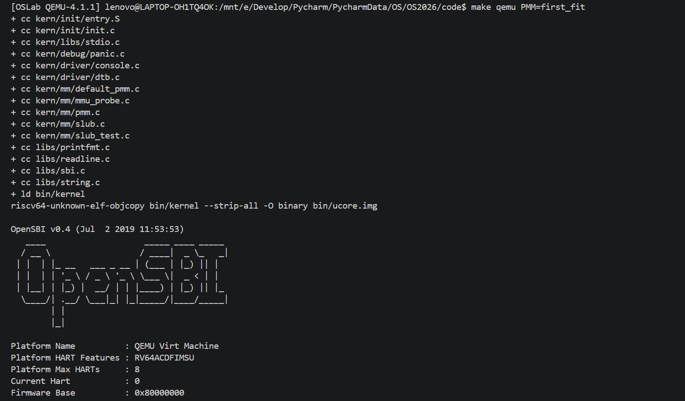

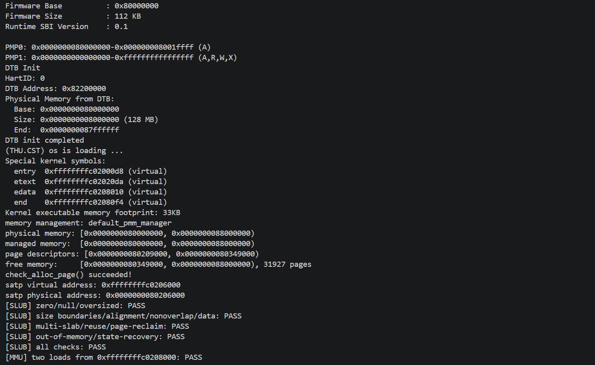

#### Buddy System

执行：

```bash
make check-buddy
```

内核串口输出与检查脚本的最终结果为：

```text
memory management: buddy_system_pmm_manager
[Buddy] init_memmap: PASS
[Buddy] split: PASS
[Buddy] coalesce: PASS
[Buddy] non-power-of-two request: PASS
[Buddy] insufficient memory: PASS
check_alloc_page() succeeded!
Buddy System integration check: PASS
```

测试覆盖了初始区域拆分、块分裂、逐层合并、非二次幂请求、内存不足、状态不变式和测试后的全局状态恢复。

完整串口片段保存在 [`logs/buddy-qemu.txt`](logs/buddy-qemu.txt)。

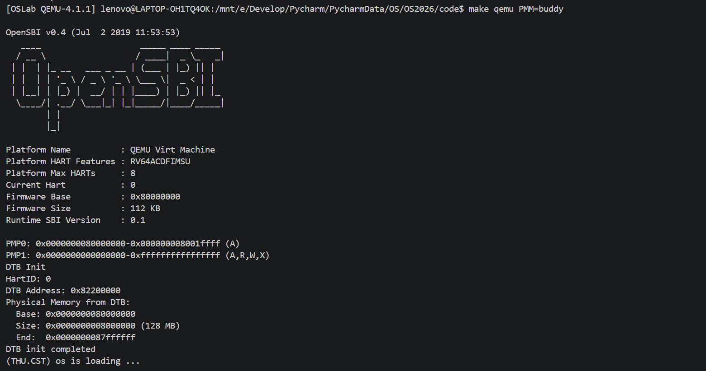

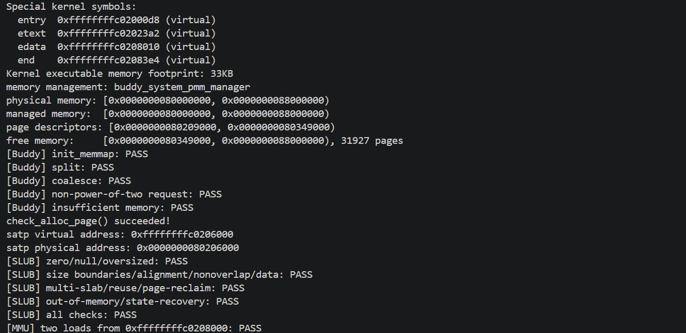

#### Best-Fit 评分与整体验证

2026-10-25 已实际执行 `make PMM=best_fit grade`，输出：

```text
  -check page init:                          OK
  -check best fit:                           OK
Total Score: 20/20
```

日志保存在 `logs/best-fit-grade.txt`。框架的 Best-Fit 附加测试本身只检查管理器
是否接入，具体选块语义由原始内置测试和上述新增行为断言共同验证。
该评分覆盖初始化和 Best-Fit；SLUB、MMU 验证见第四章及对应日志。

First-Fit、Buddy 和 Best-Fit 均已分别清理、编译并用 QEMU 4.1.1 启动，输出
`check_alloc_page() succeeded!`，未出现 panic；完整日志分别为
`logs/first_fit-integration.txt`、`logs/buddy-integration.txt` 和
`logs/best_fit-integration.txt`。内核初始化后按设计进入循环，验证程序在采集输出后
终止 QEMU；该终止属于测试收尾，不代表内核崩溃。工作区最终保留 Best-Fit 构建。

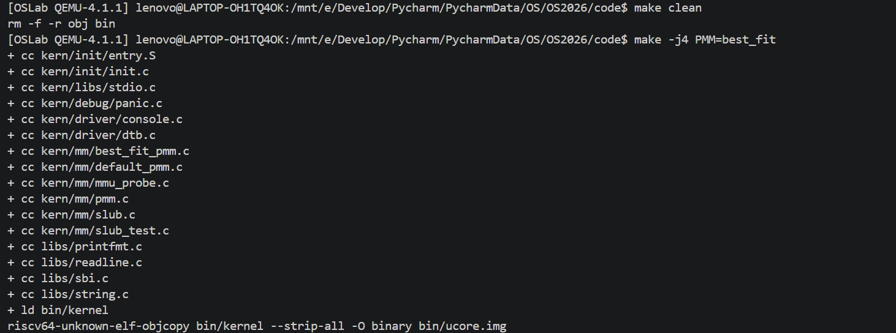

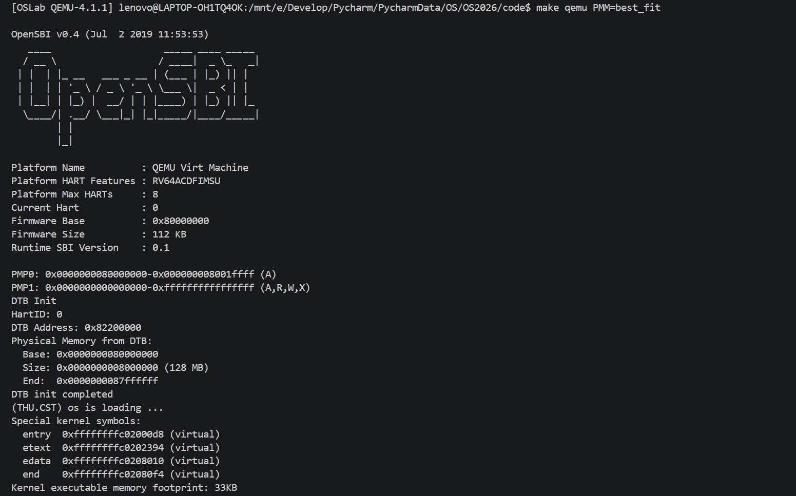

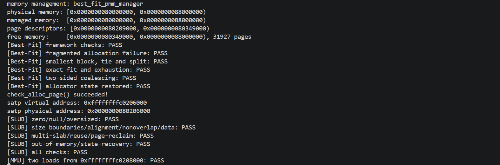

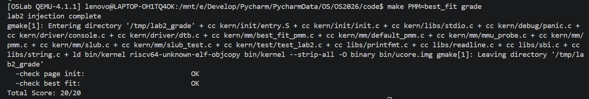

### SLUB 测试覆盖与结果

实现提示词和测试提示词分别见 [prompt.md](prompt.md) 的 SLUB 两节。
`slub_test.c` 只通过公开接口测试，不依赖内部位图的具体布局：

| 测试 | 验证内容 |
|---|---|
| 0、NULL、最大 size_t | 约定行为与溢出保护，失败不改变页数 |
| 1～8192 字节的 28 个边界请求 | 覆盖大小类前后、大对象路径、16 字节对齐 |
| 同时写入并校验不同字节模式 | 存活对象不重叠，容量足够，数据不串扰 |
| 300 个 16 字节对象 | 强制跨越多个 slab，检查全部对象内容 |
| 释放一个槽位后再次分配 | 缓存中剩余空间可复用 |
| 交错释放、反向释放 | 不同释放顺序后能归还所有物理页 |
| 有效但超过可用页的请求 | 真正内存不足时返回 NULL，不损坏状态 |

在 First-Fit、Buddy、Best-Fit 三种 PMM 上均实际输出：

```text
[SLUB] zero/null/oversized: PASS
[SLUB] size boundaries/alignment/nonoverlap/data: PASS
[SLUB] multi-slab/reuse/page-reclaim: PASS
[SLUB] out-of-memory/state-recovery: PASS
[SLUB] all checks: PASS
```

日志为 `logs/first_fit-extensions.txt`、`logs/buddy-extensions.txt`、
`logs/best_fit-extensions.txt`。当前 `kern_init()` 在 `pmm_init()` 后调用
`slub_init()` 和 `slub_check()`，验证完毕后进入 MMU 探针，最后保持原有无限循环。
First-Fit 的运行截图见第五章；Best-Fit 和 Buddy 截图分别见第五章，三种配置均显示 `[SLUB] all checks: PASS`。

### 双 GDB 调试证据

以下截图记录客体两次加载、宿主调用栈、页表项读取、TLB 回填及总检查结果。细节截图展示调试脚本保存的实际日志，完整记录见 `logs/mmu-guest-gdb.txt` 和 `logs/mmu-host-gdb.txt`。

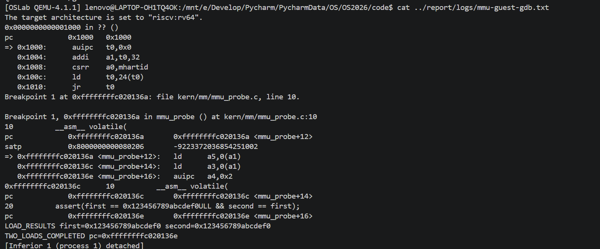

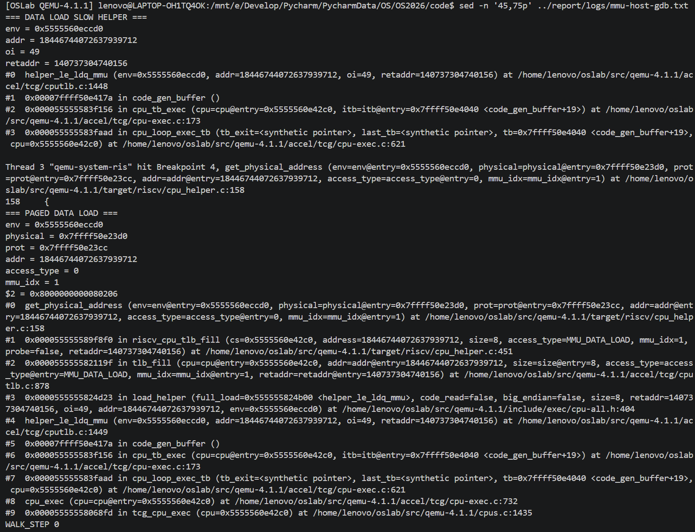

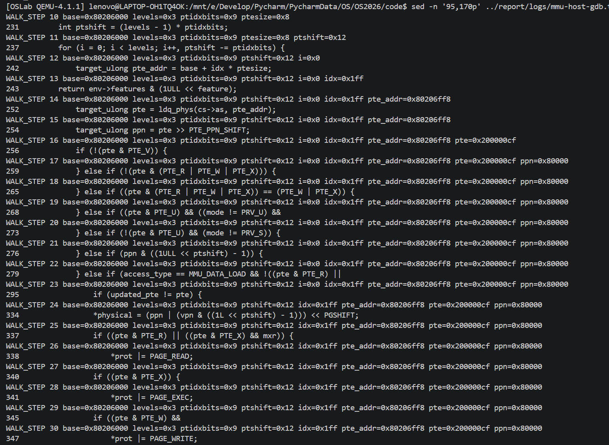

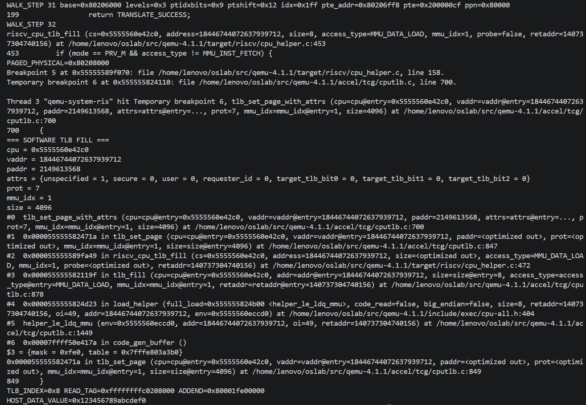


### 综合验证流程

综合验证依次运行三种物理页分配器下的扩展测试、Buddy 专项测试、双 GDB 地址翻译调试和框架评分：

```bash
make check-extensions
make check-buddy
make clean
make -j4 PMM=best_fit
make trace-mmu
make PMM=best_fit grade
```

集成验证会实际编译三种 PMM，最终保留 Best-Fit；grade 会清理当前构建，之后
单步调试前可再次执行 `make -j4 PMM=best_fit`。加入 SLUB 和 MMU 探针后
镜像增大，Best-Fit 当前描述符区为 `[0x80209000,0x80349000)`，空闲页数为
31927；不能把之前 31929 页的历史日志当成镜像布局必须固定的断言。

---

## 六、实验总结与收获

### 对操作系统的理解

#### 复杂度与碎片

设空闲块数为 `F`，本次处理页数为 `n`，可管理页数为 `M`。以下计入释放时的逐页描述符检查；Buddy 的一致性调试检查还需遍历空闲块。

| 操作或特征 | First-Fit | Best-Fit | Buddy System |
|---|---|---|---|
| 查找并分配 | 最坏 `O(F)`，找到首个适配块即停止 | 最坏 `O(F)`，选择最小适配块 | 阶查找与分裂 `O(log M)` |
| 释放 | `O(n+F)` | `O(n+F)` | 逐页检查与合并 `O(n+log M)` |
| 初始化 | 逐页描述符处理，另含链表插入 | 逐页描述符处理，另含链表插入 | 逐页初始化，拆成自然对齐块 |
| 碎片特点 | 可能存在外部碎片 | 可能形成较多小块，不保证优于 First-Fit | 二次幂取整产生内部碎片，也可能缺少足够大的块 |

#### 实现边界

1. Buddy 支持的最大块阶为 31，远高于当前 QEMU 的 128 MiB 物理内存规模。
2. 非二次幂请求按向上取整分配，因此可能存在内部碎片。
3. `free_pages(base, n)` 必须使用与分配时相同的请求页数，否则无法还原实际块阶。
4. 当前实现没有并发锁；Lab2 的内核初始化路径是单处理器、单执行流。
5. 当前分支没有实现连续页迁移、页面置换或内存热插拔。
6. Buddy 模块通过 `PMM=buddy` 选择；本次集成后默认分配器改为 Best-Fit，仍可显式选择 First-Fit。

#### 与 OS 原理的对应关系

Page 描述符和空闲链表属于软件的物理页资源管理；PTE、satp 和 TLB 属于
地址转换及权限检查，两者职责不同。分配器返回 Page 描述符，不会自动建立页表映射。
First-Fit / Best-Fit 讨论的是连续块选择与外部碎片；Buddy 的二次幂取整还引入
内部碎片。本实验使用 4 KiB 页与单执行流初始化，尚未实现进程独立地址空间、
缺页按需分配、页面置换、写时复制、并发同步或 Linux 完整 SLUB 的 per-CPU 等优化。

本实验完成了从设备树获取物理内存范围、建立 Page 描述符数组，到通过统一 `pmm_manager` 接口管理连续物理页的流程。初始化时先保留固件、内核和描述符数组占用区域，再把剩余完整页交给具体分配器，保证可分配页范围与元数据一致。

First-Fit 按地址寻找首个适配块，结构简单；Best-Fit 搜索最小适配块，减少单次分配的剩余空间，但可能形成小碎片；Buddy 依靠自然对齐、阶链表和伙伴关系快速分裂与合并，同时承担二次幂取整的内部碎片。三种算法都需要维护块头标志、链表和空闲页计数，并在分配失败时保持状态不变。

First-Fit、Best-Fit 与 Buddy 均通过 QEMU 4.1.1 内核启动验证，Best-Fit 框架评分为 20/20。原始测试与确定性测试共同覆盖了选块、分裂、合并、耗尽、碎片化失败和全局状态恢复。物理页管理、对象分配和 MMU 调试分别使用独立测试验证。

### 本实验未覆盖的重要 OS 原理

进程调度负责多执行流之间的 CPU 分配，本实验只有启动阶段的单执行流；缺页处理、页面置换和交换空间负责按需装入与容量扩展，本实验只管理驻留物理页。进程独立地址空间与写时复制负责隔离和共享，本实验使用固定的内核启动映射。多核同步、TLB shootdown 与并发内存回收负责跨核一致性，本实验没有实现这些机制。文件系统和持久化存储也不在本实验的实现范围内。

### AI 协作开发的经验

提示词需要先给出接口、输入边界、状态不变式和验收依据，再要求生成代码。仅有 PASS 输出不足以说明实现正确，必须同时核对最小适配语义、对象内容、页数恢复和真实调用栈。发现问题后应将可复现的症状和期望行为补进规格；例如 MMU 调试必须区分 CPU 访存与 GDB 内存查询，Buddy 合并必须同时检查块结构和空闲页计数。

### 参考资料

- [练习与 SLUB Challenge](http://oslab.mobisys.top/lab2026/_book/lab2/lab2_2_1_exercise.html)
- [QEMU 页表查询调试任务](http://oslab.mobisys.top/lab2026/_book/lab2/lab2_4_qemu_mmu_debug.html)
- [实验报告要求](http://oslab.mobisys.top/lab2026/_book/lab2/lab2_5_labs_requirement.html)
