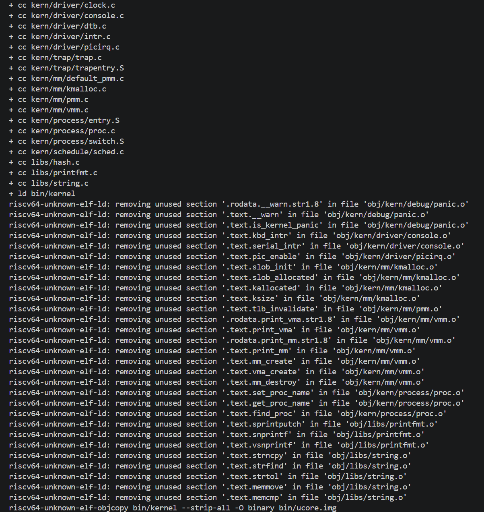
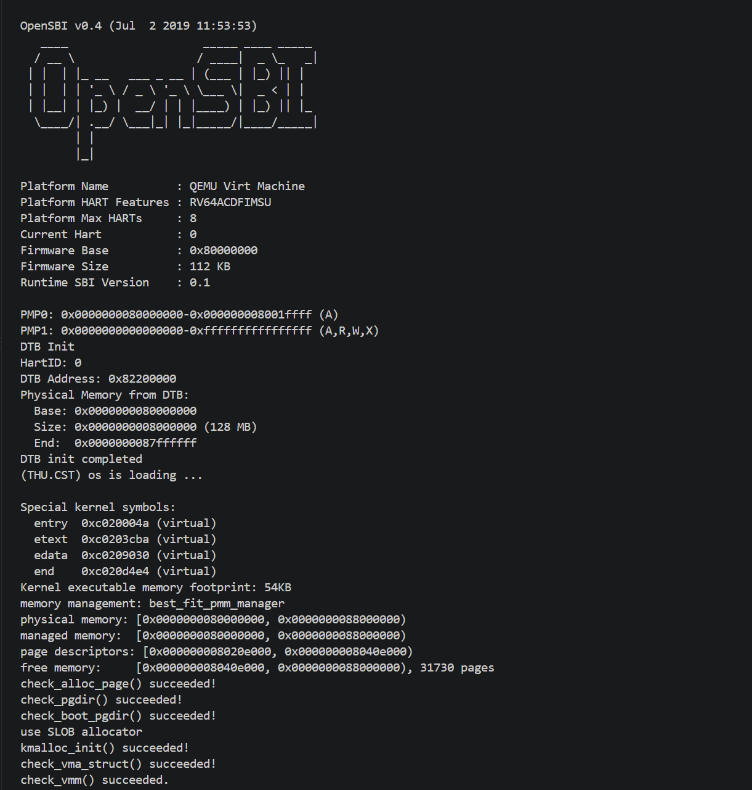
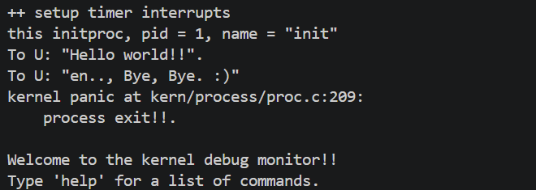
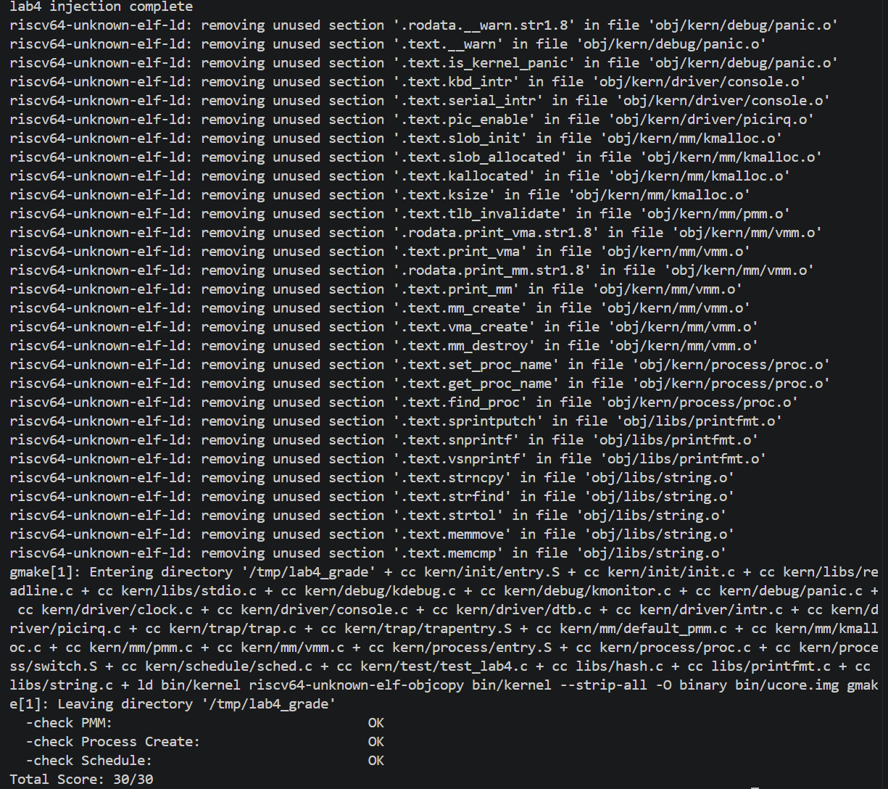

# 操作系统实验报告

## 实验基本信息

| 项目 | 内容 |
|------|------|
| **实验名称** | Lab4：进程管理 |
| **小组成员** | 2413603-常侯鑫、2411834-张岩、2413404-邓耀飞 |
| **完成日期** | 2026-11-20 |

### 小组分工

| 成员 | 负责的练习/模块 |
|------|----------------|
| 2413603-常侯鑫 | 前置依赖迁入；模块一：page_insert、page_remove；Challenge：深入理解不同分页模式的工作原理（思考题） |
| 2411834-张岩 | 模块二：进程创建与初始化；负责对应报告、Prompt 和 PCB/线程启动原理 |
| 2413404-邓耀飞 | 模块三：调度与上下文切换；Challenge：中断保存与恢复；最终集成验证 |

报告分工：常侯鑫负责前置依赖、页映射模块及分页思考题；张岩负责进程创建模块、PCB 与线程首次运行原理；邓耀飞负责调度与切换模块、中断思考题和集成测试。各成员编写对应的 Spec、Prompt、问题与解决方法。

---

## 一、实验目的

1. 理解 Sv39 页表映射、物理页引用计数和 TLB 一致性。
2. 掌握内核线程控制块、内核栈和首次运行现场的构造。
3. 理解线程选择、页表切换和寄存器上下文切换的分工。

---

## 二、实验环境

| 成员 | AI 编程工具 | 底层模型 | 备注 |
|------|------------|---------|------|
| 2413603-常侯鑫 | Codex | GPT-6.1 Sol | 依赖迁入与页映射模块 |
| 2411834-张岩 | Codex | DeepSeek V4 Flash | 进程创建与初始化模块 |
| 2413404-邓耀飞 | Codex | GPT-6 | 调度与上下文切换模块、中断保存与恢复思考题、集成验证 |

最终集成环境为 WSL GNU/Linux、GNU Make、RISC-V GCC 14.2.0、QEMU 4.1.1、OpenSBI v0.4 和 gdb-multiarch。

---

## 三、实验整体逻辑分析

### 3.1 本章节的逻辑主线

初始化物理内存与页表后，构造可运行的内核线程，再通过调度器分配 CPU，保存旧线程并恢复新线程的上下文。

### 3.2 功能的逐步实现

1. 迁入物理内存管理和 Trap 处理基础，保留 Lab4 新增接口。
2. 完成页映射与解除映射，维护引用计数和 TLB。
3. 创建 idleproc 和 initproc，构造 trapframe 与 context。
4. 通过 cpu_idle、schedule、proc_run、switch_to 完成线程运行切换。

---

## 四、实验内容与实现

### 前置依赖：物理内存管理与 Trap

**负责人：** 2413603-常侯鑫

#### 模块功能描述

从已完成的 Lab3 分支迁入其包含的 Lab2 内存管理与 Lab3 Trap 实现。page_init 根据 DTB 内存范围初始化 Page 描述符和空闲内存；分配器提供内核栈及页表所需的连续物理页；Trap 入口保存寄存器，调用 C 处理函数并恢复现场。

Lab4 的 default_pmm.c 原有自检针对 Best-Fit，迁入既有 Best-Fit 实现并以 default_pmm_manager 对外提供接口，保留原自检。保留 Lab4 的 forkrets、get_pte、SSTATUS_SUM 设置和中断保护包装。时钟处理保留事件重新装载和计数，不迁入 Lab3 演示用自动关机阈值，以免终止 Lab4 线程执行。

#### 最终提示词

本阶段实际任务指令的结构化整理见 prompt.md 的“框架准备与前置依赖迁入”。

````markdown
[PROMPT]

检查仓库状态，从更新后的 main 准备独立 lab4 分支；将提供的 Lab4 框架整理到 code/，按实验报告模板准备 report/report.md、report/prompt.md 和 report/images/；补入 Lab2、Lab3 前置实现。可以使用对应的 lab2、lab3 分支。

[RELY]

- 已提交的 Lab2/Lab3 分支提供物理页初始化、分配器、Trap 处理和汇编恢复实现。
- Lab4 已提供 get_pte、forkrets、Sv39 页表结构、进程框架和原有评分工具。
- default_pmm.c 原有自检为 Best-Fit，需匹配分配策略并保留自检。

[GUARANTEE]

保留原作者学号；按函数迁入并适配 Lab4 接口，不覆盖新增框架。只准备框架与依赖，暂不实现三个 Lab4 模块，不提交或推送。

[SPECIFICATION]

Pre-Condition：检查工作区及远程分支后进行操作，保存本地旧实验遗留产物。
Post-Condition：仓库当前分支为 lab4；代码与报告分目录；前置实现可单独编译。
Case 1：迁入 page_init，使用 Lab4 的内存宏和 Page 布局。
Case 2：迁入与现有自检匹配的 Best-Fit 实现，导出 default_pmm_manager。
Case 3：迁入中断与异常处理，保留定时器重新装载，不迁入 Lab3 自动关机限制。
Case 4：补全 RESTORE_ALL 和 __alltraps 调用，保留 forkrets。
Requirements：不修改原评分工具或自检，不伪造测试结果，不引用尚不存在的截图。
````

#### 实现迭代过程

迁入时发现 default_pmm.c 引用了未提供的 best_fit_pmm.h，而实际对外接口为 default_pmm_manager。改用现有 default_pmm.h，并将既有 Best-Fit 管理器导出名称适配为 default_pmm_manager；原自检函数保持不变。Lab4 Page 新增的页面置换链表和虚拟地址字段在 page_init 中一并初始化。

### 功能模块一：虚拟内存页操作

**负责人：** 2413603-常侯鑫

#### 模块功能描述

代码位于 `code/kern/mm/pmm.c`，保留 `//LAB4 function1 2413603` 标记。

```c
int page_insert(pde_t *pgdir, struct Page *page, uintptr_t la, uint32_t perm);
void page_remove(pde_t *pgdir, uintptr_t la);
```

`page_insert` 先通过 `get_pte(pgdir, la, 1)` 查找或创建末级页表项。成功后先增加目标物理页的引用计数；若原映射就是同一页，则撤销多加的引用，更新权限后保持原引用计数。若原映射指向其他页，则通过内部辅助函数 `page_remove_pte` 撤销旧映射并减少旧页引用，引用归零时释放旧页。最后用 `pte_create(page2ppn(page), perm)` 写入新项，并调用 `tlb_invalidate`。

`page_remove` 使用 `create=0` 查询，保证删除动作不分配页表。页表不存在或目标项无效时直接返回，因此重复删除是安全的。有效映射先清空页表项、刷新对应 TLB，再减少物理页引用；引用归零后释放。它不回收中间页表页，后者由页表生命周期管理或框架自检统一处理。

对于分配失败，`page_insert` 返回 `-E_NO_MEM`，且不改变目标页引用。如果 `get_pte` 刚创建第一级目录页，却在下一次分配失败，则撤销该新目录并释放它，恢复失败前的空闲页数量；原先存在的目录不在回滚范围内。

当前接口沿用框架的 4 KiB 末级页映射约定，不扩展为大页拆分接口。`perm` 保留框架及调用者给出的权限；仅有 `PTE_V` 的测试项可用于软件页表检查，真正访问映射仍需符合 RISC-V 的 R/W/X 权限约束。

#### 最终提示词

提示词见 [prompt.md](prompt.md) 的“页映射操作”。实现后的需求稿依据[提示词工程说明](http://oslab.mobisys.top/lab2026/_book/lab0.5/2_prompt_engineering.html)修订，明确标记为修订稿，不将其视为先前代码生成时逐字使用的原始记录。

提示词从“让内核具备页映射维护能力”描述任务，再列接口和上下文。`[RELY]` 区分虚拟地址、物理页号和 Page 描述符，说明 `get_pte` 的分配副作用及引用计数语义；`[GUARANTEE]` 列出公开接口、允许修改的范围和应保留的框架；`[SPECIFICATION]` 以新建、同页更新、替换、有效删除、无映射删除、分配失败六类场景规定可观察结果，而不规定具体算法步骤。

每类结果都有检查依据：页表项的页号和权限、引用计数、空闲页数量、错误码以及重复操作后的状态。TLB 失效要求通过失效调用审查和映射访问自检核对，不能仅凭 PTE 内容断言缓存已经更新。

````markdown
[PROMPT]

为 Lab4 内核提供普通物理页的映射维护能力：调用者能够将已分配的物理页映射到指定虚拟地址，更新该地址的目标页或访问权限，并安全撤销映射。所有操作必须保持页表项、物理页引用计数及 TLB 翻译结果一致，避免释放仍被使用的物理页或在失败时泄漏资源。

功能位于 `code/kern/mm/pmm.c`，对外通过 `page_insert()` 与 `page_remove()` 提供。任务限于现有 Sv39 框架下的 4 KiB 普通页映射，不扩展大页拆分、用户地址空间复制、进程创建或调度功能。

[RELY]

- `pgdir` 是页表根的内核虚拟地址；`la` 是目标虚拟地址，映射粒度为其所在的 4 KiB 页，页内偏移不改变映射目标页。
- `struct Page *page` 是已分配物理页的描述符，不是物理地址。`page2ppn()` 提供物理页号，`pte_create()` 编码页号与权限，`pte2page()` / `pde2page()` 将有效项转换为对应页描述符。
- 现有 `get_pte(pgdir, la, create)` 查询末级项；`create=0` 不分配，`create=1` 可能分配中间页表页，失败返回 `NULL`，且可能已建立部分中间结构。
- 可使用 `page_ref_inc()`、`page_ref_dec()`、`free_page()` 和 `tlb_invalidate()`。一次有效映射持有一个物理页引用，引用归零后才能释放该物理页。中间页表页具有独立的生命周期。
- 权限使用现有 `PTE_V`、`PTE_R`、`PTE_W`、`PTE_X`、`PTE_U` 等宏。保留框架对软件检查项的约定；用于实际访存的权限须符合 RISC-V 约束。
- 框架提供 `check_pgdir()`、`check_boot_pgdir()` 和 `tools/test_lab4.c` 中的 PMM 检查，可作为正常映射路径的验证依据。

[GUARANTEE]

提供以下公开接口，保持签名不变：

```c
int page_insert(pde_t *pgdir, struct Page *page, uintptr_t la, uint32_t perm);
void page_remove(pde_t *pgdir, uintptr_t la);
```

允许添加内部辅助函数及必要的 TLB 一致性修正；保持 `get_pte()` 公开接口、页表布局、现有自检和评分标准不变。保留 `LAB4` 标记，将本模块 `YOUR CODE` 替换为 `2413603`。不修改其他成员的进程创建、调度与上下文切换模块。

[SPECIFICATION]

**Pre-Condition**：`pgdir` 指向有效页表；插入时 `page` 指向合法、已分配的物理页描述符，原有映射与引用计数一致。目标路径符合框架的普通页约定，调用环境不并发修改同一路径。

**Post-Condition**：插入成功返回 `0`，目标项有效、物理页号及权限符合参数；删除成功后目标映射不存在。所有成功变更对应的旧 TLB 翻译均失效，引用计数和空闲页状态与最终映射一致。

**Case 1：建立新映射**。目标地址原先未映射时，成功后映射到目标物理页，该页引用计数恰好增加 1，其他映射不受影响。

**Case 2：同页更新权限**。目标地址原先已映射同一物理页时，成功后权限反映新的 `perm`，该页引用计数和空闲页数量不因重复映射发生变化；该页不得被释放。

**Case 3：替换目标页**。目标地址原先映射另一物理页时，成功后旧映射不再存在，新页引用增加 1，旧页引用减少 1；旧页仍有其他引用时保留，归零时释放。

**Case 4：删除有效映射**。删除后该项无效，原物理页引用减少 1，仅在归零时释放；其他映射及中间页表页保留。

**Case 5：删除未映射地址**。页表路径缺失或末级项无效时直接返回，不分配页表、不改变引用计数和空闲页数量。连续删除同一地址与删除一次的最终状态一致。

**Case 6：内存不足**。无法建立所需页表时返回 `-E_NO_MEM`，已有映射、目标页引用计数及调用前的空闲页数量保持不变，不遗留本次失败产生的中间页表或有效末级映射。

**Requirements**：验证须对应上述结果，包括同页更新、共享页替换、重复删除和中间页表分配失败。区分编译检查、模块运行和完整评分，仅报告实际结果。实现顺序和内部辅助结构由实现者选择，不用伪代码代替功能需求。
````

#### 实现迭代过程

实现时重点处理两类边界：同页更新不能先释放原物理页，否则可能将仍需映射的页放回空闲链表；多级页表分配失败不能遗留新建的空目录。采用“先持有新引用、再处理旧映射”和“仅撤销本次新建目录”的方式解决。TLB 失效汇编增加 `memory` clobber，约束编译器对页表内存访问的重排。

### 功能模块二：进程创建与初始化

**负责人：** 2411834-张岩

#### 模块功能描述

本模块位于 `code/kern/process/proc.c`，保留 `//LAB4 function2 2411834` 标记，实现 `alloc_proc`、`proc_init`、`kernel_thread`、`do_fork`、`copy_thread` 和 `copy_mm`。它负责把内核从“只能顺序执行初始化代码”推进到“具有线程控制块、内核栈、首次运行现场和可登记的新内核线程”。

**需要实现/修改的函数：**

```c
static struct proc_struct *alloc_proc(void);
void proc_init(void);
int kernel_thread(int (*fn)(void *), void *arg, uint32_t clone_flags);
int do_fork(uint32_t clone_flags, uintptr_t stack, struct trapframe *tf);
static void copy_thread(struct proc_struct *proc, uintptr_t esp, struct trapframe *tf);
static int copy_mm(uint32_t clone_flags, struct proc_struct *proc);
```

`struct proc_struct` 是本实验的进程控制块，也承担内核线程控制块的作用。`state` 和 `need_resched` 描述线程是否可参与调度；`pid`、`parent`、`list_link` 和 `hash_link` 用于身份、父子关系及两类索引；`kstack` 保存独立内核栈的虚拟地址；`context` 保存切换后继续执行的入口和栈；`tf` 保存一次完整 Trap 现场；`mm` 和 `pgdir` 描述地址空间。Lab4 的内核线程共享内核页表，因此 `mm` 为空，`pgdir` 统一设置为 Sv39 页表根的物理地址 `boot_pgdir_pa`。

`alloc_proc()` 通过 `kmalloc()` 创建 PCB。所有会影响后续资源管理的字段都显式初始化：状态为 `PROC_UNINIT`，pid 为 -1，父进程、内存管理结构和 trapframe 为空，切换上下文清零，名称清零，链表节点完成自环初始化。`proc_init()` 初始化进程链表和 pid 哈希桶，再把当前初始化现场包装为 pid 0 的 `idleproc`。该线程直接复用 `bootstack`，将 `need_resched` 置 1，并把 `current` 指向自身。随后 `kernel_thread()` 创建 pid 1 的 `initproc`。

`kernel_thread()` 先构造临时 trapframe。`gpr.s0` 保存目标函数，`gpr.s1` 保存参数，`epc` 指向 `kernel_thread_entry`。`sstatus` 中设置 `SPP`，使 `sret` 返回 Supervisor 模式；设置 `SPIE` 以保留返回后的中断使能模板；清除 `SIE`，确保首次上下文尚未完全建立时不会提前进入中断。临时 trapframe 交给 `do_fork()` 后，`alloc_proc()`、`setup_kstack()`、`copy_mm()` 和 `copy_thread()` 共同完成 PCB、两页内核栈、地址空间和首次运行现场。

`copy_thread()` 把 trapframe 放在新内核栈顶端，把子线程的 `a0` 清零，并让 `gpr.sp` 指向新线程可用的内核栈。`context.ra` 指向 `forkret`，`context.sp` 指向 trapframe。`do_fork()` 在中断保护区内分配 pid、加入 pid 哈希桶和进程链表，最后调用 `wakeup_proc()` 将线程设为 `PROC_RUNNABLE`。本阶段 `copy_mm()` 不复制用户地址空间，只检查当前内核线程没有 `mm`，并让新线程继续共享内核地址空间。

内核线程首次运行的调用链如下：

```text
schedule
  -> proc_run
  -> switch_to(load context.ra/context.sp)
  -> forkret
  -> forkrets(current->tf)
  -> __trapret
  -> sret(sepc=kernel_thread_entry)
  -> kernel_thread_entry
  -> fn(arg)
```

这条链把两类上下文区分得很清楚：`struct context` 只覆盖普通函数之间的线程切换，`struct trapframe` 则覆盖 RISC-V 的寄存器、`sstatus` 和 `sepc` 恢复。`kernel_thread_entry` 把 `s1` 中的参数移入 `a0`，再跳转到 `s0` 保存的函数指针。`forkrets` 把 trapframe 地址放入 `sp`，`__trapret` 恢复全部寄存器和四个 CSR，最后由 `sret` 进入预定入口。

#### 最终提示词

完整结构化 Prompt 见 [prompt.md](prompt.md) 的“张岩：进程创建与初始化”。其中 `[RELY]` 明确 PCB 字段、页表物理地址、内核栈、`context` 与 `trapframe` 的关系，以及 `sstatus.SPP/SPIE/SIE` 的含义；`[GUARANTEE]` 固定六个函数接口和允许修改的范围；`[SPECIFICATION]` 分别规定 PCB 初始化、idleproc、initproc、首次运行现场、并发登记和失败清理的可观察结果。

````markdown
[PROMPT]

在现有 Lab4/RISC-V uCore 框架中实现模块二“进程创建与初始化”。只修改 `code/kern/process/proc.c` 的模块二位置，完成 `alloc_proc`、`proc_init`、`kernel_thread`、`do_fork`、`copy_thread` 和 `copy_mm`，并保留 `//LAB4 function2 2411834` 标记。完成后内核应能创建 `idleproc` 与 `initproc`，新线程能够沿 `switch_to -> forkret -> forkrets -> __trapret -> kernel_thread_entry -> fn(arg)` 的首次运行链路进入目标函数。不得修改调度、上下文切换、页映射、评分工具和测试文件。

[RELY]

- `struct proc_struct` 是进程/线程控制块。`state`、`pid`、`parent`、`kstack`、`mm`、`context`、`tf`、`pgdir`、`name`、`list_link` 和 `hash_link` 共同描述线程状态、资源和调度信息；刚分配但尚未登记的 PCB 必须完成逐字段初始化。
- `idleproc` 不是由普通 `fork` 复制出的线程，而是把调用 `proc_init` 时的执行现场包装成 pid 为 0 的内核线程。它使用启动阶段的 `bootstack`，并由 `need_resched = 1` 触发第一次调度。
- 内核线程共享内核地址空间。`boot_pgdir_pa` 是 SV39 页表根的物理地址，可直接交给 `satp`；不能把 `boot_pgdir_va` 当作页表物理基址。
- `alloc_pages(KSTACKPAGE)` 返回连续物理页，`page2kva()` 得到其内核虚拟地址。新线程的 trapframe 位于 `kstack + KSTACKSIZE` 下方，`context.sp` 指向该 trapframe。
- `struct context` 只保存切换所需的 `ra`、`sp` 和 `s0` 至 `s11`。新线程的 `context.ra` 设置为 `forkret`；切换后由 `forkret` 恢复 `current->tf`。
- `forkrets` 把 `a0` 中的 trapframe 地址装入 `sp`，再跳转到 `__trapret`。恢复寄存器后执行 `sret`，使用 trapframe 中的 `sepc` 与 `sstatus` 进入首次运行入口。
- `kernel_thread_entry` 把 `s1` 中的参数移入 `a0`，再通过 `s0` 跳转目标函数。因此模板 trapframe 必须把函数指针放在 `gpr.s0`、参数放在 `gpr.s1`，把 `epc` 设为 `kernel_thread_entry`。
- `sstatus.SPP` 决定 `sret` 返回的特权级，内核线程应返回 Supervisor 模式；`SSTATUS_SPIE` 保存进入时允许中断的状态，模板中应清除 `SSTATUS_SIE`，避免在上下文尚未完全建立时被中断。
- `get_pid()` 依赖 `proc_list` 分配唯一 pid；`hash_proc()` 把已分配 pid 的 PCB 加入哈希桶；`wakeup_proc()` 把非僵尸、非就绪线程改为 `PROC_RUNNABLE`。
- `do_exit` 仍为框架占位实现，本次不扩展退出回收逻辑。

[GUARANTEE]

提供并保持以下接口：

```c
static struct proc_struct *alloc_proc(void);
void proc_init(void);
int kernel_thread(int (*fn)(void *), void *arg, uint32_t clone_flags);
int do_fork(uint32_t clone_flags, uintptr_t stack, struct trapframe *tf);
static void copy_thread(struct proc_struct *proc, uintptr_t esp, struct trapframe *tf);
static int copy_mm(uint32_t clone_flags, struct proc_struct *proc);
```

允许增加内部失败清理标签，但不得改变现有头文件接口、进程状态枚举、`proc_struct` 字段或其他成员已经完成的功能。

[SPECIFICATION]

**Pre-Condition**：`kmalloc`、物理页分配器和 `boot_pgdir_pa` 已初始化；调用 `proc_init()` 时当前执行现场可作为一个内核线程；模块三最终提供 `schedule()`、`proc_run()` 和 `switch_to()`。

**Post-Condition**：`proc_list` 与 1024 个 pid 哈希桶已初始化；`idleproc` 的 pid 为 0、状态为 `PROC_RUNNABLE`、内核栈为 `bootstack`、父进程和 `mm` 为空；`initproc` 的 pid 为 1、父进程为 `idleproc`、状态为 `PROC_RUNNABLE`、具有独立内核栈和经过初始化的首次运行现场。

**Case 1：分配 PCB**。`alloc_proc()` 必须返回安全初始化的 PCB，或内存不足时返回 `NULL`。初始状态为 `PROC_UNINIT`，pid 为 -1，`runs`、标志和名称等字段为 0/NULL，`pgdir` 为内核页表物理地址。

**Case 2：初始化 idleproc**。`proc_init()` 先建立全局结构，再分配并登记 `idleproc`；`current` 指向 `idleproc`。该线程不需要新建内核栈。

**Case 3：创建 initproc**。`kernel_thread(init_main, "Hello world!!", 0)` 返回正 pid。新线程拥有 `KSTACKPAGE` 个连续页的内核栈，其 trapframe 位于栈顶，`context.ra=forkret`，`context.sp` 指向 trapframe。

**Case 4：构造首次运行现场**。模板 trapframe 清零后设置 `s0` 为目标函数、`s1` 为参数、`epc` 为 `kernel_thread_entry`；`sstatus` 显式进入 Supervisor 模式并保留中断使能模板，同时暂时关闭 S 模式中断。

**Case 5：登记新线程**。pid 分配、哈希表插入、进程链表插入和 `nr_process` 增加应处于同一中断保护区间，之后 `wakeup_proc()` 新线程。成功后 `do_fork()` 返回子线程 pid。

**Case 6：失败清理**。PCB 分配失败时不泄漏资源；内核栈分配失败时释放 PCB；后续初始化失败时先释放内核栈，再释放 PCB。进程总数达到 `MAX_PROCESS` 时返回 `-E_NO_FREE_PROC`。

**Case 7：本阶段地址空间语义**。`copy_mm()` 只服务于内核线程，要求 `current->mm == NULL`，并使新线程的 `mm` 为空。用户地址空间复制留给后续实验。

**Requirements**：至少验证进程对象创建、`idleproc/initproc` 字段、pid、链表/哈希登记、内核栈与 trapframe 地址、模块二目标文件编译，以及模块三接入后的首次线程启动。不得把模块二编译通过等同于整组 `make grade` 已通过。
````

#### 实现迭代过程

实现中首先检查了 `boot_pgdir_va` 和 `boot_pgdir_pa` 的区别。进程切换最终需要把页表根物理页号写入 `satp`，因此 PCB 不能保存内核虚拟地址。其次检查了 RISC-V 的首次启动栈：`__trapret` 会恢复 trapframe 中保存的 `sp`，所以内核线程不能沿用“参数 stack 为 0”的旧习惯，而应在 `copy_thread()` 中回退到新线程的内核栈。

失败路径按资源取得顺序逆序清理：内核栈分配失败时释放 PCB；地址空间初始化失败时先释放内核栈、再释放 PCB。pid/链表/哈希登记的复合更新放入 `local_intr_save/restore` 临界区，避免同一时刻观察到只完成一半的进程登记状态。

`proc.c` 已通过 RISC-V 交叉编译。与模块三的 `schedule()`、`proc_run()` 和 `switch_to()` 集成后，线程创建与首次启动均通过验证，最终评分见第五节。

### 功能模块三：调度与上下文切换

**负责人：** 2413404-邓耀飞

#### 模块功能描述

代码位于 `code/kern/process/proc.c`、`code/kern/schedule/sched.c` 和 `code/kern/process/switch.S`。

**需要实现/修改的函数：**

```c
void cpu_idle(void);
void schedule(void);
void proc_run(struct proc_struct *proc);
void switch_to(struct context *from, struct context *to);
```

`cpu_idle()` 检查 `need_resched` 并触发调度；`schedule()` 关闭中断并清除调度标记，从当前线程之后循环查找非 idle 的 `PROC_RUNNABLE` 线程，跳过链表头和不可运行线程，没有候选时使用 idle。idle 即使登记在链表中也只作为保底选项，不能抢在真实可运行线程前面。选中后增加 `runs`，仅在目标不同于 current 时调用 `proc_run()`。

`proc_run()` 在中断保护区内更新 `current`，将 `(SATP_MODE_SV39 << 60) | (proc->pgdir >> RISCV_PGSHIFT)` 写入 satp，刷新 TLB，然后调用 `switch_to()`。这里的 pgdir 是物理地址，不能使用 Sv32 的 `lsatp()`。

`switch_to()` 按 `struct context` 布局保存和恢复 `ra`、`sp`、`s0` 至 `s11`，共 14 个 64 位字段。`a0` 和 `a1` 分别指向旧、新 context，最后 `ret` 跳到新 context.ra。由于这是正常函数调用边界，调用者负责临时寄存器和参数寄存器，不需要像 Trap 入口一样保存全部通用寄存器。

新线程的 ra 预设为 forkret，因此第一次切换沿 `forkret -> forkrets -> __trapret -> sret -> kernel_thread_entry -> fn(arg)` 执行；旧线程再次被选中时，恢复自己的栈，继续执行上次 switch_to 后的中断状态恢复。

#### 最终提示词

四段式提示词见 `prompt.md` 的“邓耀飞：调度与上下文切换”，依赖项明确 context 偏移、Sv39 satp 和首次启动链路；规格覆盖正常选择、空闲保底、无需切换及重复恢复。

````markdown
[PROMPT]

在现有 Lab4 工程中实现模块三，完成 `cpu_idle()`、`schedule()`、`proc_run()` 和 `switch_to()`。直接修改实际文件，保留其他成员完成的页映射与进程创建逻辑，将模块三标记中的 YOUR CODE 替换为 2413404。完成后内核线程应能够首次启动并在多次主动调度后恢复执行。

[RELY]

- `proc_list` 登记线程，`current` 为当前线程，`idleproc` 为空闲线程；`PROC_RUNNABLE` 表示可运行，`need_resched` 表示需要重调度，`runs` 记录被调度次数。
- `struct context` 按顺序包含 `ra`、`sp`、`s0` 至 `s11`，每项在 RV64 下占 8 字节；RISC-V 调用约定允许普通函数调用破坏临时和参数寄存器。
- `local_intr_save()` 保存 SIE 并关闭本核中断，`local_intr_restore()` 按原状态恢复；嵌套调用必须各用独立局部变量。
- `proc->pgdir` 是页表根物理地址；Sv39 satp 的 MODE 为 8，位于高四位，PPN 为物理地址右移 12 位。`lsatp()` 是 Sv32 遗留接口，不适用于本任务。
- 新线程已有 `context.ra=forkret`、`context.sp=tf`，首次运行沿 `forkret -> forkrets -> __trapret -> kernel_thread_entry` 进入目标函数。
- 可用 `list_next()`、`le2proc()`、`write_csr()`、`flush_tlb()` 和现有进程接口。

[GUARANTEE]

```c
void cpu_idle(void);
void schedule(void);
void proc_run(struct proc_struct *proc);
void switch_to(struct context *from, struct context *to);
```

保持公开接口和数据布局不变；不扩展进程退出回收或用户地址空间复制。

[SPECIFICATION]

**Pre-Condition**：进程链表、当前线程和空闲线程已经初始化；线程具有合法内核栈与页表，目标 context 已保存或构造完毕。

**Post-Condition**：一次调度选出可运行线程并统计运行次数；发生切换时 `current`、satp 和实际寄存器现场一致；原线程再次被调度后能够从原调用点继续执行。

**Case 1：空闲循环**。`cpu_idle()` 持续检测 `need_resched`，需要调度时调用 `schedule()`，不返回初始化函数。

**Case 2：选择线程**。清除当前调度标记，从当前线程之后按链表顺序循环寻找非 idle 的 runnable 线程；从 idle 出发时由链表头开始。跳过表头、阻塞线程和 idle，遍历无结果时使用 idle。

**Case 3：无须切换**。选中当前线程时只增加运行次数，不切换寄存器或页表；空表及没有其他 runnable 线程时必须终止查找。

**Case 4：切换执行现场**。在中断保护区内更新 `current`，写入合法的 Sv39 satp 并刷新 TLB，再通过 `switch_to()` 保存旧 context、恢复新 context。每个线程返回自己的调用栈后恢复其保存的中断状态。

**Case 5：首次启动与再次恢复**。新线程返回到预设的 `forkret`，已有线程返回到上次 `switch_to()` 调用之后。汇编必须按真实 context 偏移保存和恢复全部 14 项，不能用 Trap frame 的偏移。

**Requirements**：实现线程选择、页表切换和寄存器切换的职责划分；保护切换临界区；运行完整构建、普通启动与原有评分。工具链兼容修正不得删除断言、降低分值或伪造 PASS；报告只记录真实结果。
````

#### 实现迭代过程

四个接口实现后，全量构建通过，普通启动成功进入 initproc。正式评分前依次处理四项兼容问题：`kmalloc.c` 将传给 `kva2page` 的整数地址显式转为 `void *`；测试线程返回类型由 void 改为与 `kernel_thread` 一致的 int，并补充不可达 return；通过 `.gitattributes` 固定 Shell 脚本为 LF；GDB 缺少交叉版本时回退到 gdb-multiarch，并在评分连接 QEMU 前加载 bin/kernel、指定 riscv:rv64。

最初评分出现空串口输出，调试发现 gdb-multiarch 报 `Truncated register 37 in remote 'g' packet`，内核并未获准继续执行。显式指定架构后，原有三组评分均通过。未改变测试断言、评分分值或调度压力；测试线程仍多次主动让出 CPU。

本实验框架 `do_exit()` 仍调用 panic。initproc 输出结束后进入调试监控器属于该占位行为，不能描述成已实现线程退出回收。

---

### Challenge：深入理解不同分页模式的工作原理（思考题）

**负责人：** 2413603-常侯鑫

#### 不同分页模式与相似代码

| 模式 | 运行架构 | 页表级数 | 每级索引位数 | 页表项大小 | 普通页大小 |
|------|----------|----------|--------------|------------|------------|
| Sv32 | RV32 | 2 | 10 | 4 字节 | 4 KiB |
| Sv39 | RV64 | 3 | 9 | 8 字节 | 4 KiB |
| Sv48 | RV64 | 4 | 9 | 8 字节 | 4 KiB |

Sv39 的有效虚拟地址按 `VPN[2]、VPN[1]、VPN[0]、12 位页内偏移` 分解，高位须按第 38 位符号扩展；Sv48 则多一层索引，高位按第 47 位扩展。多级页表把稀疏地址空间的页表页按需分配，减少未使用地址范围的开销，代价是硬件遍历级数增加，需要 TLB 缓存翻译结果。

本项目实际使用 Sv39：`PDX1` 取位 38～30，`PDX0` 取位 29～21，`PTX` 取位 20～12，每级 512 项。`mmu.h` 顶部存在 Sv32 的旧说明，判断当前实现应以这些宏和 Sv39 的 satp 配置为准。

`get_pte` 的两段相似代码分别处理根页表到中间页表、中间页表到末级页表的导航。每一层都要检查有效位；缺失且允许创建时，分配一页、置引用计数、清零，再把页号写入父级目录项。操作相似源于多级页表逐层索引的结构相同，但两段访问的层级和索引不同。Sv32 对普通页只需一次中间目录处理，Sv39 为两次，Sv48 为三次。通用实现可按层数循环，但还需辨别叶子项和大页，不能直接把所有有效项都当作下一级页表。

#### 页表查询与分配是否应拆分

现有 `get_pte(pgdir, la, create)` 将两者统一，便于小型内核复用遍历代码：`create=0` 只查找，`create=1` 按需分配，调用方代码短且易懂。缺点是布尔参数隐藏了分配、失败和回滚等副作用；查询调用若误传 1，会意外占用物理页，分配失败还可能留下中间结构。

在较大内核中，建议对外拆成纯查询和确保页表存在两个明确接口，内部共享逐层遍历代码。纯查询不分配，创建接口集中管理权限、锁、失败回滚及 TLB 维护。没有必要为拆分复制两套遍历代码，也不必为了本思考题修改框架公开接口。本实现保留 `get_pte` 接口，在 `page_insert` 中补足当前创建路径的失败回滚。

### Challenge：中断保存与恢复

**负责人：** 2413404-邓耀飞

`local_intr_save(intr_flag)` 调用 `__intr_save()`：读取 `sstatus.SIE`，若为 1 则关闭中断并返回 1，否则返回 0。结束时 `local_intr_restore(intr_flag)` 仅在保存值为 1 时重新打开中断。因此进入前关闭的中断不会被错误打开。

嵌套时外层保存 1 并关中断，内层看到关闭状态而保存 0；内层退出保持关闭，外层退出才重新打开。每层必须保存到独立局部变量，不能共用同一个 flag。本实现的 schedule 与 proc_run 正是这种嵌套关系；切回旧线程后才恢复旧栈上保存的状态。

`do { ... } while (0)` 将宏封装成单条语句，只执行一次，保证用于 if/else 时语法完整。中断屏蔽只阻止本核可屏蔽中断造成的并发，不屏蔽同步异常，也不能阻止其他 CPU 修改共享数据；多核仍需锁和内存序机制。切换到新线程后的中断状态由其 Trap frame 和 sret 恢复，不能依赖尚未执行的旧线程恢复语句。

---

## 五、测试与验证

2026-11-18 完成全量构建、QEMU 运行与框架评分，2026-11-20 重新执行并保存下列截图。在已启用课程工具的终端中，从仓库根目录执行：

```bash
cd code
qemu-system-riscv64 --version
make clean
make -j2
make qemu
make grade
```

`make qemu` 进入内核监控器后，先退出 QEMU，再运行 `make grade`。

| 项目 | 实际结果 |
|------|----------|
| 全量构建 | 通过，生成内核及镜像 |
| 物理内存与页表自检 | `check_alloc_page()`、`check_pgdir()`、`check_boot_pgdir()` 通过 |
| 动态内存与 VMM 自检 | `kmalloc_init()`、`check_vma_struct()`、`check_vmm()` 通过 |
| 普通启动 | initproc 成功运行并输出下列三行文本 |
| PMM | 10/10 |
| Process Create | 10/10 |
| Schedule | 10/10，测试线程多次主动调度后恢复执行 |
| 总分 | **30/30** |

initproc 的实际输出：

```text
this initproc, pid = 1, name = "init"
To U: "Hello world!!".
To U: "en.., Bye, Bye. :)"
```

评分由框架在源码副本中注入测试，检查 PMM、线程创建和重复调度结果。工具链兼容修正保留测试断言及分值。普通启动最后出现 `process exit!!` 并进入监控器，是框架 `do_exit()` 的占位行为；本实验未实现完整退出回收。

评分覆盖共享内核页表下的线程创建与切换，未覆盖独立用户地址空间或多核调度。

### 测试截图

**全量构建：** 内核链接及 `bin/ucore.img` 生成成功。`removing unused section` 是链接器移除未使用代码段的信息，不是构建失败。



**QEMU 运行：** 以下两张图按输出顺序连续展示，包含 OpenSBI 启动、内存与页表自检、VMM 自检、initproc 输出，以及框架退出占位触发的监控器。





**框架评分：** PMM、Process Create、Schedule 三项均为 OK，总分 30/30。



---

## 六、实验总结与收获

### 对操作系统的理解

页表是虚拟地址映射的数据结构，TLB 是硬件地址翻译缓存；修改页表后需要使旧缓存失效。PCB 管理线程状态和资源，context 只保存切换执行流所需的寄存器。本实验以内核线程为主，尚未覆盖完整用户程序加载、文件系统和多核调度。

本实验核心知识点及其与操作系统原理的对应关系如下：

| 本实验机制 | OS 原理知识点 | 关系与差异 |
|------------|---------------|------------|
| Sv39 页表与 `page_insert/page_remove` | 虚拟地址空间与分页映射 | 以多级页表按需建立普通页映射；引用计数管理物理页共享，尚未实现完整用户地址空间隔离。 |
| `tlb_invalidate` | TLB 与地址翻译一致性 | 页表是内存中的映射记录，TLB 缓存硬件翻译结果；更新前者后需要使旧翻译失效。 |
| `proc_struct` | PCB/TCB | PCB 统一管理身份、状态、栈、地址空间和链接信息。本实验的独立内存资源较少，因此同一结构也直接充当内核线程控制块。 |
| `proc_list` 与 `hash_list` | 进程索引与生命周期管理 | 线性链表用于遍历和调度，pid 哈希桶用于平均常数时间查找；本实验尚未实现完整退出、等待和回收。 |
| 两页内核栈 | 特权级切换与内核栈 | 每个线程保存自己的内核栈，Trap 和内核函数调用使用该栈；此时用户栈和内核栈切换尚未完整实现。 |
| `struct context` | CPU 上下文切换 | 只保存被调用者保存寄存器，调用者保存寄存器由编译器在普通函数调用边界处理，因此比完整进程上下文轻量。 |
| `struct trapframe` | 硬件现场与异常返回 | 保存全部通用寄存器、`sstatus`、`sepc` 等，可供 `sret` 恢复；它不包含页表、文件等软件资源。 |
| `forkret -> forkrets -> __trapret` | 新执行流的首次启动 | 通过“切换上下文到恢复 Trap 现场”的通用路径启动新线程，无需为 `kernel_thread_entry` 另写一套进入逻辑。 |
| `copy_mm()` 占位 | 地址空间复制/隔离 | 真正进程还需要复制或共享页表、维护 VMA 和引用计数；本实验的内核线程共享内核页表，故只保留接口。 |
| `schedule()` 与 `need_resched` | 就绪队列和 CPU 调度 | 从链表轮转选择 runnable 线程，idle 保底；当前验证通过主动调度进行，不等于实现完整抢占调度。 |
| `local_intr_save/restore` | 临界区与并发控制 | 保存并恢复本核中断状态，防止本核中断打断关键操作；多核共享数据仍需锁和内存序保证。 |

本实验尚未覆盖但 OS 原理中重要的内容包括：用户态进程的完整创建与 `fork` 语义、写时复制、独立页表切换的完整验证、进程退出后的僵尸态回收和父进程等待、文件描述符继承、信号机制、多核调度与锁，以及睡眠/唤醒和公平调度策略。

### AI 协作开发的经验

线程调试需要核对完整上下文链：除 PCB 字段外，还要检查 `boot_pgdir_pa`、trapframe 的位置、`context.ra`、`context.sp`、`sstatus` 和 `sp` 恢复顺序。`Process Create` 测试验证对象状态，调度测试验证线程实际启动与重复恢复，两者共同确认线程机制。

跨实验迁入需明确数据结构变化和框架保留范围，并使用编译结果核对接口兼容性，不能将旧实验文件直接整体覆盖。
